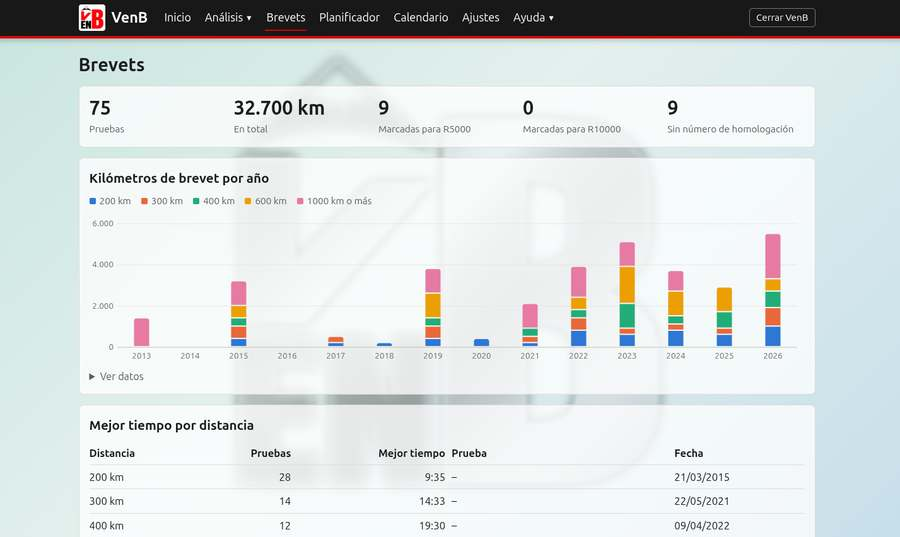
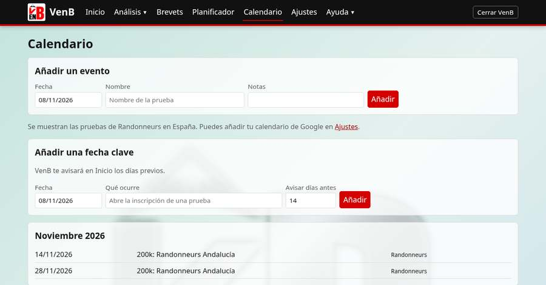
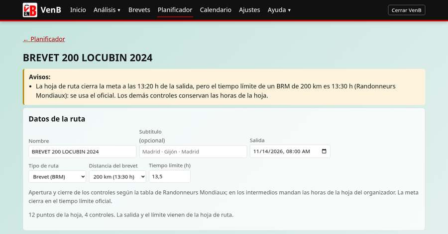
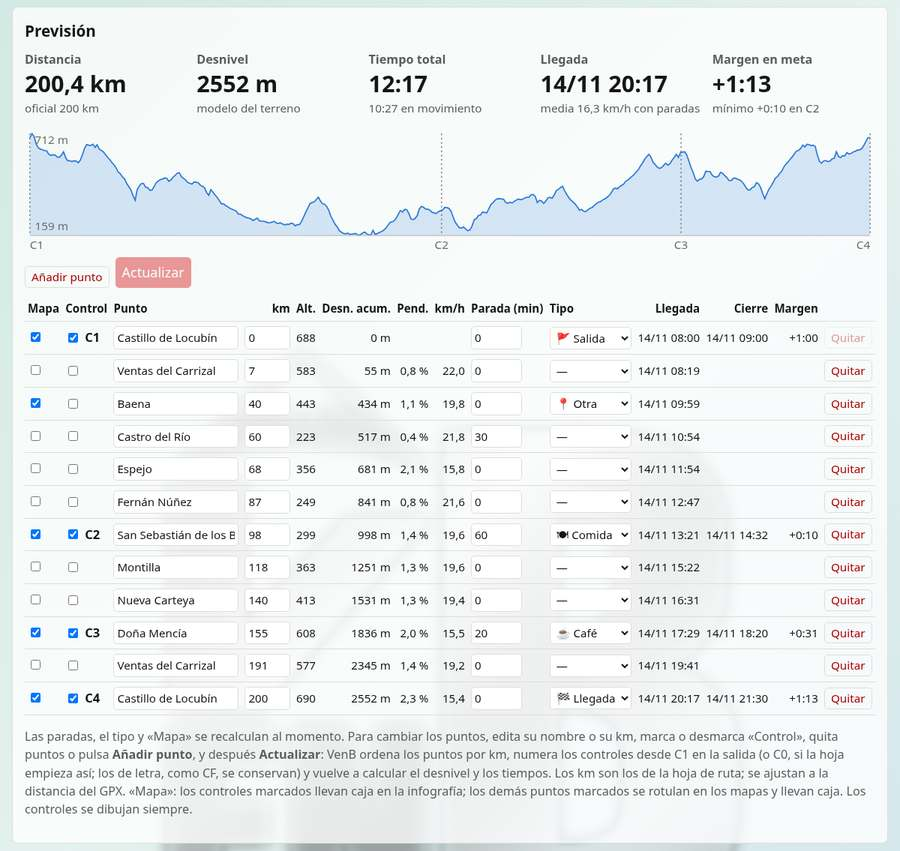
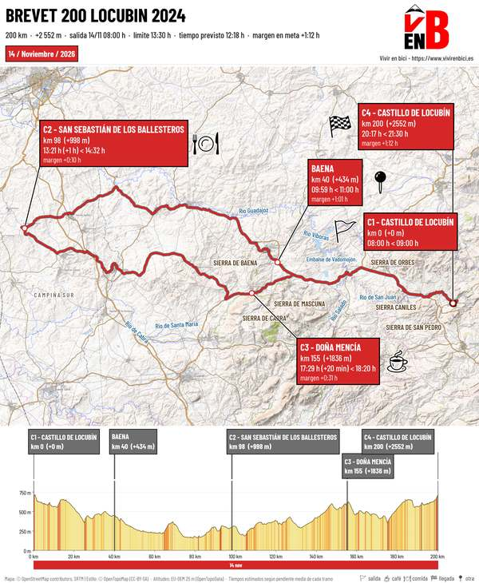
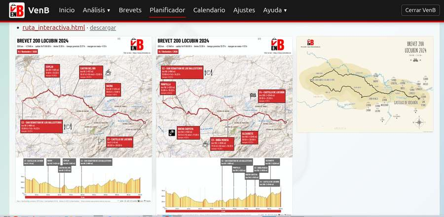

# Manual de usuario de VenB

VenB (Vivir en Bici) sirve para seguir tu entrenamiento de ciclismo, tus bicis, tus brevets y tu calendario. Funciona en tu ordenador: se abre en el navegador y tus datos no salen de él. Solo es accesible desde ese equipo, salvo que permitas el acceso desde el móvil o la tablet en tu red de casa (ver [Usar VenB desde el móvil o la tablet](#usar-venb-desde-el-movil-o-la-tablet)).

Tus actividades pueden llegar de dos formas, que se pueden combinar: desde Garmin Connect, que tiene su propio capítulo ([Importar tus datos de Garmin](garmin.md)), o subiendo ficheros GPX, FIT o TCX de cualquier dispositivo o aplicación (ver [Importar actividades de ficheros](#importar-actividades-de-ficheros)). Si no usas Garmin, desmarca **Usar Garmin Connect** en Ajustes.

El menú, siempre visible en la parte superior, tiene siete apartados: **Inicio**, **Análisis** (con Gráficas, Histórico, Importar, Bicis e Informes; **Gráficas** es la propia página Análisis), **Brevets**, **Planificador**, **Calendario**, **Ajustes** y **Ayuda** (con Manual de usuario y Acerca de). Las páginas de Análisis y Ayuda se abren al pasar el ratón por su nombre o con la flecha ▾ que tienen al lado; en el móvil y en pantallas estrechas, el menú se pliega en el botón **☰ Menú**, que lo despliega con todas las páginas a la vista. La página Análisis tiene además, arriba, una tarjeta para cada una de sus páginas y para Brevets.

En Histórico, Brevets, Calendario e Informes, cada bloque se pliega y despliega con el triángulo de su título; VenB recuerda en cada navegador cuáles dejaste plegados, y un enlace o una tarjeta que lleve a un bloque plegado lo abre.

*Las capturas de pantalla de este manual pueden ser de una versión anterior: la pantalla actual puede diferir en algún detalle.*

## Antes de instalar: Python

VenB está escrito en Python y necesita **Python 3.10 o posterior** en el ordenador. Python es libre y gratuito, y solo se instala una vez: las versiones nuevas de VenB lo siguen usando. El instalador de VenB comprueba si está y, si falta o es antiguo, avisa y ayuda a instalarlo: en Windows ofrece instalar Python en ese momento (responde `S` y sigue solo; si no puede, abre la página de descarga) y en Linux muestra la orden exacta para tu distribución. Si prefieres hacerlo a mano, sigue estos pasos.

### Comprobar si ya lo tienes

- **Windows**: pulsa la tecla Windows, escribe `cmd` y pulsa Intro. En la ventana negra escribe `py --version` y pulsa Intro.
- **Linux**: abre una terminal y escribe `python3 --version`.

Si responde `Python 3.10` o un número mayor (por ejemplo, `Python 3.15.2`), ya lo tienes: pasa a [Primeros pasos](#primeros-pasos). Si dice que no reconoce la orden, o la versión es menor, sigue leyendo.

### Windows

1. Entra en [https://www.python.org/downloads/](https://www.python.org/downloads/) y pulsa el botón **Download Python** de la versión más reciente. Descárgalo solo de esa web oficial.
2. Abre el fichero descargado. Según la versión, será el **instalador de Python** o el **Python install manager** (administrador de instalaciones). Los dos sirven.
3. Con el **instalador de Python**, antes de nada marca abajo la casilla **Add python.exe to PATH** y pulsa **Install Now**. Si al final aparece **Disable path length limit**, púlsalo también.
4. Con el **Python install manager**, acepta lo que propone. Si pregunta si quieres instalar ya la última versión de Python, responde que sí (`Y` e Intro).
5. Cierra todas las ventanas de `cmd` abiertas, abre una nueva y comprueba la versión con `py --version`.

### Linux

Casi todas las distribuciones traen Python 3. Aun así, conviene asegurarse de que están el módulo para crear entornos (`venv`), `pip` y `curl`, que el instalador de VenB usa para descargar sus componentes. En una terminal, según tu distribución:

| Distribución | Orden |
|---|---|
| Ubuntu, Linux Mint, Debian | `sudo apt install python3 python3-venv python3-pip curl` |
| Fedora | `sudo dnf install python3 python3-pip curl` |
| openSUSE | `sudo zypper install python3 python3-pip curl` |
| Arch, Manjaro | `sudo pacman -S python python-pip curl` |

Te pedirá tu contraseña. Si tu distribución es antigua y trae una versión de Python menor que la 3.10 (por ejemplo, Ubuntu 20.04), lo más sencillo es actualizar la distribución.


### Si algo falla

- **Windows dice que falta Python aunque lo has instalado.** Seguramente no se marcó **Add python.exe to PATH**. Vuelve a abrir el instalador de Python, elige **Modify**, pulsa **Next**, marca **Add Python to environment variables** y pulsa **Install**. Después, cierra y vuelve a abrir la ventana.
- **Al escribir `python` se abre la Microsoft Store.** Windows trae un acceso directo que suplanta a Python. Desactívalo en **Configuración → Aplicaciones → Configuración avanzada de aplicaciones → Alias de ejecución de aplicaciones**, apagando los de `python.exe` y `python3.exe`.
- **En Linux, el instalador de VenB falla al crear el entorno.** Instala los paquetes de la tabla anterior (sobre todo `python3-venv` y `curl`) y repítelo.
- **La versión es menor que la 3.10.** Instala la más reciente desde python.org (Windows) o actualiza la distribución (Linux).

## Primeros pasos

1. Comprueba que tienes Python (ver [Antes de instalar: Python](#antes-de-instalar-python)) y descomprime el ZIP donde quieras (en Windows: botón derecho sobre el ZIP > **Extraer todo**). Después, en la carpeta extraída, haz doble clic en **INSTALAR-EN-WINDOWS** (Windows) o ejecuta `bash instalar-en-linux.sh` en una terminal abierta en ella (Linux). Hace falta conexión a internet. La primera vez, el instalador propone instalar VenB en `Documentos\VenB` (Windows) o `~/VenB` (Linux): pulsa Intro para aceptar o escribe otra carpeta. Allí quedan el programa y, a su lado, `VenB-datos`, con tus datos.
2. Ábrela con su icono. Se abre una terminal, que debe seguir abierta, y el navegador.
3. En **Ajustes**, indica el mes en que empieza tu temporada.
4. En **Análisis → Bicis**, da de alta tus bicis.
5. Vuelve a **Ajustes** y elige a qué bici se asignan los kilómetros de rodillo.
6. Incorpora tus actividades: [desde Garmin](garmin.md) o [subiendo ficheros](#importar-actividades-de-ficheros). Sin ellas, Bicis, Brevets y Calendario funcionan, pero Inicio y Análisis quedan casi vacíos.

Para cerrar VenB, usa el botón **Cerrar VenB** o pulsa Ctrl+C en la terminal.

## Inicio

Resume lo que necesitas saber hoy:

- **Avisos:** datos de Garmin atrasados, peso sin anotar, fechas clave próximas, meses por cerrar y sesiones con un sensor sin datos (ver [Sensores sin datos](#sensores-sin-datos)). Sus umbrales se cambian en Ajustes. La **×** cierra un aviso para siempre; si vuelve a darse la situación otro día u otro mes, aparece un aviso nuevo. El del cierre del mes enlaza con la página Bicis.
- **Tu estado:** forma, fatiga y frescura, horas de la semana, km de bici del mes, sueño, VFC, FC en reposo, mejor potencia de 20 minutos de los últimos 30 días y peso.
- **Forma y fatiga** de los últimos 3 meses.
- **Último consejo**, si hay alguna revisión con consejo (consulta [Informes](#informes)).
- **Próximos eventos** y el formulario para **anotar tu peso**. Lo que anotas a mano manda sobre el peso de Garmin de ese día. Si en Ajustes el peso viene de Garmin, también se envía a Garmin Connect (con la hora actual si es de hoy, o a las 12:00 si es de otro día).
- **Últimas actividades:** las 5 más recientes y, en el desplegable, las 20 anteriores. VenB trae lo nuevo de Garmin Connect al abrirse y cada pocas horas; **Traer lo nuevo de Garmin** lo hace en el momento (ver [Abrir VenB](garmin.md#4-abrir-venb)). Un asterisco junto al TSS indica que está estimado por duración. Con **✎** cambias el nombre de una actividad (ver [Histórico](#historico)).

## Análisis

Arriba, las tarjetas **Brevets**, **Histórico**, **Importar**, **Bicis** e **Informes** llevan a esas páginas, que también están en el submenú de Análisis. Debajo están las **Gráficas**; los botones de periodo eligen 3 meses, 6 meses, 1 año, 3 años o todo:

- **Entrenamiento:** forma y fatiga, frescura, horas de bici y mejor potencia de 20 minutos por mes.
- **Salud y peso:** sueño, VFC, FC en reposo y peso.

Las gráficas de todo tu historial (kilómetros por año, acumulados, por mes y salidas según su distancia) están en el [Histórico](#historico).

**Ver datos**, bajo cada gráfica, muestra sus valores en una tabla.

## Bicis

### Dar de alta una bici

Pulsa **Dar de alta una bici** e indica:

- **Nombre** y, si quieres, número de serie, platos y piñones.
- **Km iniciales:** lo que ya lleva la bici. Las piezas elegidas empiezan a contar desde esa cifra hasta que anotes su primer cambio.
- **Piezas que quieres seguir**, y otras separadas por comas.
- **Juegos de ruedas**, separados por comas, si usas más de uno. Sus kilómetros se anotan por separado y cada juego lleva sus cubiertas. Un juego ya creado no se puede quitar.

Para retirar una bici con historial, edítala y desmarca **En uso**: seguirá en las gráficas. Solo se puede borrar una bici sin historial.

### Anotar los kilómetros de cada mes

Los kilómetros de cada bici se guardan por meses. VenB te muestra los que registran las actividades, en exterior y en rodillo, y los propone en las casillas:

- **Bici de cada salida.** Las salidas con bici, la que indiques tú (en la lista de salidas del mes, debajo, o en la columna **Bici** del [Histórico](#historico)) o la que traigan de Garmin Connect (ver [Bicis de Garmin Connect](#bicis-de-garmin-connect)), suman sus km en la casilla de esa bici. Elige «Otra (no mía)» para BiciMAD o una bici alquilada o prestada: cuenta como entrenamiento, pero no suma km a tus bicis ni al total del mes. Las bicis retiradas también se pueden elegir, para salidas antiguas.
- **Rodillo.** Lo que no tenga bici asignada se propone en la bici del rodillo elegida en Ajustes. Si allí está marcada **En rodillo, esta bici manda sobre la de Garmin Connect** (lo está por defecto), las sesiones de rodillo van siempre a ella, porque Garmin suele ponerles su bici por defecto.
- **Salidas sin bici.** El cuadro incluye una **estimación sin confirmar**, en la proporción de los 3 meses anteriores con datos; **Sumar la estimación** la añade a las casillas vacías o que aún tienen la propuesta.

Lo propuesto no se guarda hasta que pulses **Guardar**. El cuadro muestra el total del mes, lo asignado y lo pendiente, y se actualiza al escribir. Corrige los km escribiéndolos o con los botones **−** y **+** de cada casilla: cambian de 5 en 5 km y avanzan solos si los mantienes pulsados. Puedes guardar aunque no cuadre con el total.

VenB te recuerda **cerrar el mes** entre los días indicados en Ajustes (por defecto, del 28 al 7 del mes siguiente). Un mes cerrado se puede editar, pero nunca cambia solo: si después asignas la bici de una de sus salidas, VenB te lo advierte y sus km guardados siguen igual hasta que los corrijas tú. Para abrir otro mes, usa **Ver otro mes** o **Registros mensuales**.

### Bicis de Garmin Connect

Si en Garmin Connect eliges la bici de cada actividad (su «Equipo»), VenB la aprovecha. En **Bicis de Garmin Connect**, al final de la página, aparecen tus bicis de Garmin con su número de actividades: elige a qué bici de VenB corresponde cada una (y con qué juego de ruedas, si tiene varios) y pulsa **Guardar**. VenB propone la correspondencia cuando los nombres se parecen. Desde entonces, sus actividades quedan asignadas a esa bici, también las antiguas.

- Una bici de Garmin **sin correspondencia** (por ejemplo, una que no está en VenB) deja sus actividades pendientes de asignar, como las que no tienen bici en Garmin.
- Lo que elijas en VenB para una actividad manda sobre Garmin. En el Histórico, «Según Garmin Connect» indica que la bici viene de Garmin; si quitas la tuya, vuelve la de Garmin.
- VenB vuelve a leer las bicis de Garmin una vez al día, al abrir la página Bicis, o cuando pulsas **Leer ahora de Garmin Connect**. Hace falta la cuenta de Garmin configurada en Ajustes.

### Anotar una pieza o una visita al mecánico

En **Anotar mecánico o pieza cambiada**, indica fecha, bici, quién hizo el trabajo, taller y coste. Después marca las piezas cambiadas o describe el trabajo en **Otra pieza o trabajo**.

Al marcar una pieza, su contador vuelve a cero en esa fecha. Cada bici muestra los kilómetros de sus piezas desde el último cambio, y **Historial de mecánico y piezas** permite editar o borrar lo anotado.

## Brevets

Aquí se registran las pruebas oficiales, aparte de tus actividades: un brevet no se distingue de una salida larga solo por los datos de Garmin. La página tiene cinco bloques plegables: Resumen, Kilómetros de brevet por año, Mejor tiempo por tipo de prueba, Registrar un brevet e Historial.



Para no escribir los datos a mano, VenB ofrece registrar las salidas en bici de 190 km o más que no están en la lista: **Inicio** pregunta por las de los últimos 60 días, y el **Histórico** tiene en todas el botón **Incluir en la lista de brevets**. El formulario se abre con la fecha, el nombre, el tiempo y la distancia homologable (la mayor de 200, 300, 400, 600, 1.000, 1.200… que no supere la grabada en más de un 5 %: 213 km → 200). Revisa el tipo, completa la homologación y los clubes y pulsa **Guardar**. VenB avisa y no guarda nada si la prueba ya está registrada (con la misma actividad, o con la misma fecha y distancia). Una prueba de varios días partida en etapas se registra desde la primera, con la distancia y el tiempo totales. Si fue una salida sin más, cierra el aviso de Inicio con la **×** o pulsa **No es prueba**.

La página **Salidas largas por clasificar** (enlace al principio de Brevets) reúne todas las salidas largas que no están en la lista, sin límite de fechas: cada una tiene **Sí, es una prueba** (abre el formulario) y **No es prueba** (no vuelve a salir), y arriba **Marcar todas como no pruebas**, útil si tu historial tiene muchas salidas largas que no fueron pruebas. Abajo, en **Marcadas como no prueba**, se recupera una marcada por error. Si quedan salidas anteriores sin clasificar, Inicio lo dice en un solo aviso. Al importar ficheros, VenB pregunta al terminar por cada salida larga importada. La distancia y los días se cambian en **Ajustes**.

También puedes registrar una prueba a mano en el bloque **Registrar un brevet**, que empieza plegado. Una prueba registrada así no queda enlazada con ninguna actividad: si la ruta está grabada (también una SB o una SR de varios días), promuévela desde el Histórico o desde Salidas largas por clasificar, una vez por etapa, en lugar de crearla a mano, o sus kilómetros se contarán dos veces. El formulario es para las pruebas que no se grabaron y para los km que faltan sin GPS. Los campos son:

- **Tipo:** BRM (brevet), SB (superbrevet, de 1.200 km o más), SR (Super Randonnée), Flecha u Otro.
- **Fecha** y **distancia**, obligatorias, junto con el **nombre**.
- **Tiempo**, en formato H:MM. Puede superar las 24 horas.
- **Homologación.** Las pruebas sin número aparecen como pendientes.
- **Club organizador** y **club de inscripción**.
- **R5000** y **R10000**, para marcar las pruebas que cuentan para esos reconocimientos.

Una prueba grabada en una sola actividad se registra con la fecha de salida y su tiempo total. Si está **partida en varias actividades** (una de varios días, o una que se cortó), registra una fila por actividad con sus km y su tiempo reales y el tipo de la prueba entera, y llámalas igual con el número de etapa al final: «PBP2019_Etapa01», «PBP2019_Etapa02»… Si faltan kilómetros porque no se grabaron, añade otra fila con el resto y el nombre terminado en «_SinGPS». Así los km son los reales y no se cuentan dos veces. En el resumen, el número de pruebas, los tramos por distancia, el R5000 y el R10000 cuentan cada prueba una sola vez, aunque tenga varias etapas.

La página muestra además los totales, los kilómetros por año, el mejor tiempo por tipo de prueba (cada distancia de BRM, las SR, cada superbrevet y las Flechas; las pruebas por etapas, con su tiempo total de la primera salida a la última llegada) y el historial, en una caja que se desplaza por dentro, con los botones **Editar** y **Borrar** en cada fila. El nombre de cada prueba (↗) abre en Garmin Connect su actividad: la enlazada o, si no la hay, la salida en bici de distancia más parecida de ese día, el anterior o el siguiente.

## Histórico

Reúne todas tus actividades. Arriba, las tarjetas **Brevets**, **Planificador de rutas**, **Importar**, **Bicis** e **Informes** llevan a esas páginas. Debajo hay tres bloques de gráficas que se pliegan y despliegan con su triángulo (VenB recuerda en cada navegador cuáles dejaste abiertos):

- **Kilómetros de bici por año:** la gráfica y la tabla con las salidas, los km, las horas, el desnivel y la salida más larga de cada año. Al pulsar un año, la lista muestra sus salidas.
- **Todo tu histórico:** kilómetros acumulados en el año (el actual frente al anterior y, en gris, los tres previos) y salidas según su distancia.
- **Kilómetros por mes:** cuanto más oscuro, más kilómetros.

Debajo está la lista de **Actividades**, también plegable (al filtrar o pulsar un año se abre sola), que puedes filtrar por título, año, tipo y kilómetros mínimos. Si dos grabaciones de bici se solapan, se conserva la más larga. El título de las actividades que vienen de Garmin (de más de 7 km, o de los que pongas en Ajustes; 0 = todas; marcado con ↗) abre la actividad en Garmin Connect en una pestaña nueva; el enlace depende de que la actividad tenga número de Garmin, no de que la conexión con Garmin esté activada, así que también aparece en las del historial exportado de Garmin. Las subidas a mano no lo tienen: llevan la etiqueta **Fichero** y el botón **Borrar**, que la quita de VenB junto con su fichero.

El botón de la última columna (un pequeño perfil) abre una ventana con el **resumen de la actividad**: distancia, tiempo en movimiento y total, velocidad media (o ritmo, si es a pie), desnivel, altitud mínima y máxima, frecuencia cardiaca, potencia, TSS, calorías y bici, según lo que haya grabado, con el perfil altimétrico y el recorrido. Al pasar el ratón o el dedo por el perfil, se ven la distancia y la altitud, y su posición en el recorrido. El perfil sale del recorrido descargado de Garmin o del fichero subido a mano; las actividades anteriores a la primera descarga de Garmin (las del historial exportado) solo traen el resumen.

En la columna **Bici** de las salidas en bici puedes elegir con qué bici las hiciste (ver [Anotar los kilómetros de cada mes](#anotar-los-kilometros-de-cada-mes)); se guarda al momento. «Según Garmin Connect» indica que la bici viene de Garmin.

Las salidas en bici de 190 km o más tienen, en la última columna, el botón **Incluir en la lista de brevets** (ver [Brevets](#brevets)) o la etiqueta **En la lista**, si ya corresponden a una prueba registrada o son una etapa suya.

Para cambiar el nombre de una actividad, pulsa ✎ junto a su título, aquí o en las últimas actividades de Inicio. En las de Garmin, el nombre cambia en Garmin Connect, con la sesión de garmindb, y en todo lo sincronizado con Garmin; hace falta conexión a internet. En las subidas a mano, y en todas si Garmin Connect está desactivado en Ajustes, cambia solo en VenB.

## Importar actividades de ficheros

En **Análisis → Importar** subes actividades grabadas con cualquier dispositivo o aplicación, sin pasar por Garmin Connect: ficheros **GPX**, **FIT** o **TCX** (también comprimidos en `.gz`), muchos a la vez.

1. Elige los ficheros y pulsa **Leer los ficheros**.
2. Revisa la tabla: fecha, título (editable), tipo de actividad, km, horas, desnivel, FC y potencia media. **Ciclismo en sala** y **Ciclismo virtual** son rodillo. Elige la bici de cada salida, o de todas a la vez con **Bici para todas las de bici**.
3. Una actividad que coincide en el tiempo con otra que ya está en VenB, de Garmin o subida antes, aparece desmarcada y en rojo para no duplicarla. Los ficheros que no se pueden leer, como un track planificado sin horas, aparecen con su motivo.
4. Pulsa **Importar las marcadas**, o **Descartar y volver**.

De cada fichero salen la fecha y la hora (las de tu ordenador), la distancia, el tiempo en movimiento y el total, el desnivel (con la altura suavizada y sin contar oscilaciones de menos de 3 m) y, si los trae, la frecuencia cardiaca y la potencia (media, máxima, normalizada y mejor de 20 minutos). Un FIT aporta los totales del propio dispositivo. Las actividades importadas cuentan en todo VenB como las de Garmin; su TSS se estima por duración, salvo que el FIT lo traiga. El fichero original se guarda en `VenB-datos/actividades/`.

Si una actividad es de un mes que ya cerraste en Bicis, sus km no se suman solos: al terminar, VenB te ofrece un botón para sumarlos a esa bici en ese mes.

## Calendario



- **Calendarios:** arriba, un interruptor de color por calendario: Randonneurs en España (verde), tu Google Calendar si lo has añadido en Ajustes (azul), tu calendario de VenB (rojo) y las fechas clave (naranja). Pulsa uno para mostrar u ocultar sus eventos; VenB lo recuerda. Cada evento lleva un punto del color de su calendario.
- **Calendario de pruebas:** las pruebas del calendario público de Randonneurs en España y de tu Google Calendar aparecen junto a las tuyas, con una etiqueta de origen, y no se cambian desde VenB. En cada una, **Copiar** la pasa a tu calendario de VenB y abre su ficha; **Ocultar** la quita de la lista si no te interesa. Las ocultas están al final, en **Ocultos**, con **Mostrar de nuevo**. Cada mes es un bloque plegable (los tres primeros, abiertos).
- **Tu calendario de VenB:** sus eventos se añaden en **Añadir un evento o una fecha clave** (fecha, nombre y notas) o copiando una prueba. El nombre abre su ficha, donde puedes cambiar la fecha, el nombre y las notas, adjuntar el **track** (GPX) y la **hoja de ruta** de la prueba y prepararla en el Planificador: **Crear el plan** lo crea con esos ficheros, o puedes **enlazar** un plan que ya tengas. El plan muestra arriba el enlace a su prueba, y en el calendario la prueba lleva la etiqueta **Plan**. Los adjuntos se guardan en `VenB-datos/calendario/`. **Descargar en formato iCal** guarda tu calendario de VenB en un fichero `.ics` para importarlo en el móvil o en Google Calendar.
- **Fechas clave:** algo que no quieres olvidar, como la apertura de una inscripción. VenB te avisa en Inicio los días previos que indiques.

## Informes

Reúne tu diario y tus informes. Arriba, cuatro tarjetas llevan a cada sección; cada una se pliega y despliega con el triángulo de su título, y VenB recuerda en ese navegador las que dejaste plegadas.

- **Escribir una nota** y **Notas:** el diario, un sitio opcional para escribir lo que quieras sobre tus sesiones, tus sensaciones o tus rutas: fecha y texto libre. Puedes editar y borrar cada nota. Si no escribes nada, no cambia ningún cálculo. Se guarda en `VenB-datos/datos/diario.csv`.

Las otras dos secciones muestran lo que haya en la carpeta `VenB-datos`. VenB no crea estos ficheros: es un espacio para guardar tus propios informes y revisiones.

- **Informes:** cada subcarpeta de `VenB-datos/informes/` aparece con sus PDF y sus gráficas SVG.
- **Revisiones:** cada fichero `VenB-datos/estado/estado_AAAA-MM-DD.md`. La primera línea es el título, y las que empiezan por `- `, sus puntos.
- **Último consejo de Inicio:** el `notas.json` más reciente de `VenB-datos/informes/`, con este formato:

```json
{"lectura": "Texto de la revisión", "plan": ["Primera pauta", "Segunda pauta"]}
```

## Planificador

Calcula a qué hora pasarás por cada punto de una ruta y genera sus documentos. Necesita conexión a Internet (altitudes del terreno, mapas y datos de OpenStreetMap).

1. **Sube el track (GPX) y, si la tienes, la hoja de ruta.** Sin hoja, o si VenB no consigue leerla, el plan empieza con la salida y la meta del track y añades los puntos a mano en la tabla de Previsión (paso 7). La hoja puede ser la del organizador de un brevet en PDF u ODT: tablas con columnas como LOCALIDADES, KM TOTAL, ABIERTO y CERRADO (también el impreso oficial del ACP, en inglés o en francés) o una lista de líneas del tipo «km LOCALIDAD abre cierra». El PDF debe tener texto: una imagen escaneada no se puede leer. Si VenB no reconoce la hoja, o para una ruta propia, usa una **hoja de cálculo sencilla** (XLSX, ODS o CSV) con tres columnas:

    | Control | Ubicación | km |
    |---|---|---|
    | Sí | Algete | 0 |
    |  | El Casar | 17 |
    | Sí | Tamajón | 66,7 |
    | Sí | Algete | 202,4 |

    En **Control** pon «Sí» o «X» en los controles (se numeran C1, C2…) o su identificador («C3», «CF»); déjala vacía en los demás puntos. El primer punto es la salida y el último, la meta. Puede llevar una cuarta columna, **Cierre**, con la fecha y hora de cierre. La página tiene modelos para descargar en ODS, XLSX y CSV.

2. **Análisis.** VenB lee la hoja y el track y consulta las altitudes del terreno (modelo EU-DEM de 25 m, más fiable que la altitud del GPX; fuera de su cobertura, SRTM de 30 m). Si el GPX no trae altitudes, no importa: salen del terreno. Con una ruta nueva tarda uno o dos minutos; la página se actualiza sola. Si el GPX trae waypoints de control («C1 ALGETE»…), los controles se colocan donde dicen; si no, los km de la hoja se ajustan a la distancia del GPX. Los ajustes se avisan arriba.
3. **Datos de la ruta:** nombre, subtítulo, salida (en formato DD/MM/AAAA HH:MM; el botón 📅 abre un calendario de lunes a domingo con la hora), **tipo de ruta** y tiempo límite. De la hoja del organizador salen la salida, el límite y las horas de cada control, que mandan sobre las calculadas (salvo el cierre de la meta de un brevet, ver abajo). El tipo de ruta decide el resto:

    - **Brevet (BRM):** eliges la distancia (200, 300, 400, 600, 1.000 o 1.200 km) y VenB pone su tiempo límite (13:30, 20, 27, 40, 75 y 90 h) y calcula la apertura y el cierre de cada control con la tabla de Randonneurs Mondiaux: abren a 34 km/h hasta el km 200, 32 hasta el 400, 30 hasta el 600, 28 hasta el 1.000 y 26 después; cierran a 15 km/h hasta el km 600, 11,428 hasta el 1.000 y 13,333 del 1.000 al 1.300. No es una errata que la velocidad mínima suba después del km 1.000: así un 1.200 cierra en 90 h (75 h hasta el km 1.000 más 200 km a 13,333 km/h). Las pruebas de más de 1.300 km tienen otras medias mínimas para toda la prueba (12 km/h hasta 1.899 km, 10 km/h hasta 2.499 km y 200 km por día desde 2.500 km) y no están entre los brevets de VenB: elige «Libre» y pon el tiempo límite del organizador. Reglamentos: [Randonneurs Mondiaux](https://www.randonneursmondiaux.org/files/Rules_2019.pdf) y [Audax Club Parisien, reglas para organizadores de BRM](https://www.audax-club-parisien.com/wp-content/uploads/2026/02/Rules-for-organizer-2026.pdf) (en inglés). Hasta el km 60 el cierre es a 20 km/h más una hora. La meta cierra siempre en el tiempo límite oficial, aunque la ruta sea algo más larga o la hoja del organizador diga otra cosa (VenB lo avisa arriba), y el tiempo límite no se puede cambiar. Los km son los de la hoja. VenB propone «Brevet» cuando la hoja trae la distancia oficial o las horas de los controles.
    - **Super Randonnée:** 60 h para una SR 600 (cámbialo si es otra); sin horas de control, el cierre de cada punto reparte el límite en proporción a la distancia.
    - **Recorrido libre:** escribe el **tiempo deseado**; la columna «Objetivo» lo reparte en proporción a la distancia, para ver si vas por delante o por detrás.

4. **Velocidad y paradas.** La velocidad de partida es la que da la tabla por defecto en esta ruta; **Usar mi media reciente** pone la de tus salidas largas en exterior del último año. Escribe la parada de cada control y pulsa **Rellenar todas las paradas con este valor**, y cambia después las que quieras en la tabla, con su **tipo**: 🚩 Salida, ☕ Café, 🍽 Comida, 🛏 Dormir, 🚰 Agua, 🔀 Cruce, ⚠️ Peligro, ⭐ Punto de interés, 🏁 Llegada o ✳️ Otra. El icono del tipo aparece dentro de la caja del punto en la infografía, arriba a la derecha (con una leyenda de los tipos usados al pie), y en la página interactiva.
5. **El botón ?** explica el cálculo y permite cambiarlo: cada tramo tiene una velocidad según su pendiente media (ascenso del tramo / distancia), menos un porcentaje de fatiga por cada parte de la ruta recorrida. La velocidad media que escribes escala toda la tabla por igual. Todos los valores se pueden cambiar; **Valores por defecto** los recupera.
6. **Previsión.** Una tabla con todos los puntos: mapa, control, nombre, km, altitud, **desnivel acumulado** desde la salida (sumado sobre el perfil del track con las altitudes del terreno, suavizado y sin contar oscilaciones de menos de 3 m), pendiente del tramo, velocidad, parada, tipo de parada, llegada, cierre y margen. Llegada, cierre y margen se recalculan al momento cuando cambias las paradas, la salida o la velocidad. El margen es el tiempo que te queda hasta el cierre cuando reanudas la marcha, es decir, después de la parada que hayas puesto en ese punto. Un margen negativo sale en rojo, y ⚠ indica que llegas antes de que abra el control. La casilla **Mapa** decide qué puntos llevan caja en la infografía y se rotulan en los mapas (los controles se dibujan siempre). En la infografía, cada caja se coloca sola en el hueco del mapa que menos estorba: sin tapar el track ni los controles, lejos de las zonas donde el track se concentra y unida a su punto con una línea.
7. **Cambiar los puntos.** En la misma tabla puedes corregir el nombre o el km de un punto, marcar o desmarcar la casilla **Control**, quitar un punto (**Quitar**; **Recuperar** lo deshace) o añadir otro con **Añadir punto** (un café, una fuente, un puerto…). Después pulsa **Actualizar**: VenB ordena los puntos por km, numera los controles desde C1 en la salida (o desde C0, si la hoja del organizador empieza así; los identificadores con letra, como CF, se conservan) y vuelve a calcular el desnivel y los tiempos en unos segundos, conservando las paradas y las horas de la hoja de los puntos que ya estaban. Los km son los de la hoja de ruta y se ajustan a la distancia del GPX. Los puntos cambiados mandan sobre la hoja; **Volver a los puntos de la hoja** los descarta. Mientras haya cambios sin actualizar, no se puede generar.
8. **Generar.** Elige los documentos: tabla de tiempos (Excel), infografías, mapa ilustrado de estilo Al-Ballut, mapa personal, mapa «Juego de Tronos» y página interactiva (abre el mapa, el perfil y la tabla en el navegador, permite cambiar salida y paradas y, con **Descargar GPX con waypoints**, guardar la misma ruta con waypoints que se describe abajo). El mapa **«Juego de Tronos»** imita los mapas antiguos de fantasía: relieve sombreado a partir del modelo del terreno, iluminado desde el noroeste para que las sierras se vean en relieve, con colores por altitud (llanura verde, colinas ocres, sierras pardas y roca clara en las cumbres de más de 1.200 m), bosques con textura de copas, agua color petróleo, tipografía antigua y la salida con un sol rojo; conserva el cuadro de datos, el perfil y los controles numerados del mapa personal. Los tres mapas llevan, además de sierras, ríos y embalses, un pueblo en miniatura junto a cada localidad de la ruta y en los pueblos cercanos (con castillo si OpenStreetMap tiene uno, o con torre de iglesia) y árboles en las riberas y en bosquecillos repartidos por el mapa; el personal y el «Juego de Tronos», además, un puentecillo donde la ruta cruza un río dibujado (salvo si cruza en plena curva). Las infografías llevan de fondo, por defecto, el mapa topográfico del Instituto Geográfico Nacional (MTN); en **Mapa de las infografías** puedes elegir también IGN Base, la ortofoto del IGN con rótulos o los mapas de OpenStreetMap (topográfico, normal o humanitario). Los del IGN son más precisos, pero solo cubren España: si la ruta sale de España, la infografía usa el topográfico de OpenStreetMap. Con **Colorear el track de la infografía según la pendiente**, el track de la infografía toma los colores del perfil (de amarillo claro, por debajo del 2 %, a granate, por encima del 8 %), según la pendiente en el sentido de la ruta en tramos de unos 200 m; las bajadas van en amarillo claro, y en una ruta de varios días el borde del track conserva el color de cada día. La leyenda de pendientes va al pie. Cuando la infografía ocupa varias hojas, cada una indica «Hoja 1 de 2», etc., en la fila de la fecha. La página interactiva abre también con el topográfico del IGN (en España) y permite cambiarlo. En España, la posición y el nombre de las sierras y los puertos se contrastan con el Nomenclátor Geográfico del IGN: si una sierra está en los dos, manda la posición oficial; si solo está en uno, se conserva. Los pueblos, ríos, embalses y cumbres salen de OpenStreetMap. La primera vez en una zona nueva puede tardar de 10 a 15 minutos; después, segundos. Al terminar, aparecen en **Ficheros generados**: arriba, en dos columnas, las infografías y los mapas con su vista previa; debajo, la ruta con waypoints, la tabla de tiempos y la página interactiva. Cada documento tiene sus formatos (PNG, PDF, Excel o HTML) para abrirlo o descargarlo por separado, o todos juntos en un ZIP. La **ruta con waypoints** (botón **Descargar el GPX con waypoints**) está siempre, incluso antes de generar, y se rehace cada vez que cambias los puntos y pulsas **Actualizar**: un GPX con el track y todos los puntos, también los añadidos a mano, con los tipos del creador de rutas de Garmin Connect (control en los controles, inicio y fin en la salida y la llegada, genérico en el resto) y nombres en mayúsculas como «C1_CASTILLO DE LOCUBIN». El fichero se llama BRM, la distancia y la salida, con «_WP» al final (por ejemplo, BRM200_CASTILLO_DE_LOCUBIN_WP.gpx); fuera de los brevets, RUTA y los km.









Las rutas se guardan en `VenB-datos/planificador/` (una carpeta por ruta, con lo subido y lo generado) y aparecen en **Tus rutas**; desde ahí se abren de nuevo o se borran. Las copias de seguridad las incluyen. La caché de mapas y altitudes está en `.venb/mapas` y puede borrarse sin problema.

La marca de los documentos (texto y logotipo) es la de `planificador_marca` en `VenB-datos/config/ajustes.json`: `{"texto": "...", "logo": "/ruta/completa/al/logo.png"}` (un PNG; si tiene fondo blanco, se quita solo). Si no la cambias, es la del autor de VenB.

## Ajustes

Los ajustes van en tarjetas, con cada opción a la izquierda, su valor a la derecha y una ayuda breve en gris. **Guardar ajustes** guarda los de arriba; **Valores por defecto** los devuelve a los de fábrica, salvo la temporada, la bici del rodillo, tu calendario, el origen del peso y la cuenta de Garmin.

- **Temporada y bicis:** mes de inicio de la temporada, bici del rodillo (y si en rodillo manda sobre la bici de Garmin Connect) y días del recordatorio de cierre.
- **Avisos de Inicio:** días sin actividades, sin datos de salud o sin anotar peso, y referencia de sueño.
- **Sensores:** cuándo avisa el validador de sensores (porcentaje de tiempo sin datos y días hacia atrás) y qué sensores vigila. Consulta [Sensores sin datos](#sensores-sin-datos).
- **Brevets e Histórico:** distancia mínima de las salidas por las que se pregunta si fueron una prueba, días en que se pregunta en Inicio y distancia a partir de la cual el Histórico enlaza a Garmin Connect (0: todas).
- **Descargas de Garmin:** cada cuántas horas trae VenB lo nuevo mientras está abierta.
- **Planificador:** valores con que empieza cada ruta nueva: mapa de las infografías, parada en cada control y documentos marcados al generar.
- **Peso:** elige si procede de Garmin o lo anotas a mano. Consulta [Traer el peso de Garmin](garmin.md#traer-el-peso-de-garmin).
- **Garmin Connect:** la casilla **Usar Garmin Connect**. Desmarcada, VenB funciona solo con lo que subas en [Importar](#importar-actividades-de-ficheros): no descarga nada (también detiene la descarga diaria), no envía el peso ni los nombres y no lee las bicis de Garmin; lo ya descargado se conserva y sigue contando. Marcada, debajo están el correo y la contraseña de la descarga automática, la comprobación de la conexión y la primera descarga. Consulta [Importar tus datos de Garmin](garmin.md).
- **Calendario:** pega la dirección en formato iCal de tu calendario de Google, que termina en `.ics`, para añadirlo al de Randonneurs en España. Está en la configuración de cada calendario. Es secreta, porque da acceso a tu calendario: no la compartas. Se guarda en `VenB-datos/config/calendario_url.txt`. La casilla **Mostrar las pruebas de Randonneurs en España** permite ocultarlas.
- **Copia de seguridad e importación:** descarga una copia de tus datos, restaura una copia o importa la exportación de tu cuenta de Garmin. Consulta [Copia de seguridad](#copia-de-seguridad).
- **Acceso desde el móvil o la tablet:** abre VenB a tu red local con una clave. Consulta [Usar VenB desde el móvil o la tablet](#usar-venb-desde-el-movil-o-la-tablet).

## Sensores sin datos

VenB revisa las sesiones de los últimos días (7, por defecto) en busca de sensores que dejan de enviar datos: pulsómetro, potencia, cadencia, velocidad y, en exterior, GPS. Cuenta el tiempo en que el sensor está en la sesión pero no da datos, o los da congelados (el pulso con el mismo valor durante 2 minutos o más), en cortes de 5 segundos o más. Los ceros normales no cuentan: cadencia 0 en una bajada o velocidad 0 parado. En rodillo, 0 W sí cuenta, porque allí no se rueda sin pedalear.

Inicio avisa, por sesión, cuando un sensor pasa del porcentaje elegido en Ajustes (5 %, por defecto), cuando deja de enviar a mitad de la sesión y no vuelve («el pulsómetro dejó de enviar datos a los 42 min (¿batería?)») y cuando falta en toda la sesión aunque suele estar en las del mismo tipo (¿sensor sin emparejar o apagado?). Si el afectado es el potenciómetro, la potencia y el TSS de esa sesión pueden no ser fiables. **Ver la sesión** abre su resumen en el Histórico, con los avisos, el TSS marcado como poco fiable si procede y los tramos sin datos sombreados sobre el perfil. Se revisan las actividades descargadas de Garmin y las importadas de un fichero; la primera vez, la revisión se hace en segundo plano y los avisos aparecen al volver a Inicio.

## Usar VenB desde el móvil o la tablet

Puedes abrir VenB desde otros equipos conectados a la misma red que tu ordenador, por ejemplo la wifi de casa:

1. En el ordenador, en **Ajustes → Acceso desde el móvil o la tablet**, marca **Permitir el acceso desde la red local**, escribe una clave de al menos 6 caracteres y pulsa **Guardar**.
2. Cierra VenB y vuelve a abrirla. Ajustes y la terminal muestran la dirección, del tipo `http://192.168.1.20:8877` (VenB Rutas usa el puerto 8878, para que las dos puedan estar abiertas a la vez).
3. En el móvil o la tablet, escribe esa dirección en el navegador y, la primera vez, la clave. El navegador la recuerda 90 días.

Ten en cuenta:

- Solo funciona mientras VenB está abierta en el ordenador y ambos equipos están en la misma red.
- La IP del ordenador puede cambiar si el router se reinicia: mira de nuevo la dirección en Ajustes.
- Desde otro equipo se puede consultar y anotar todo, pero no cerrar VenB, cambiar la cuenta de Garmin, hacer copias de seguridad ni cambiar este apartado.
- Tras 5 claves erróneas seguidas, la entrada se bloquea 10 minutos.
- La conexión no va cifrada: actívalo solo en redes de confianza, nunca en una wifi pública.
- **Cortafuegos.** En Windows, la primera vez que abras VenB con esta opción, el sistema pregunta si permite el acceso: elige solo **Redes privadas**. En Linux, si usas `ufw`, abre el puerto para tu red, por ejemplo `sudo ufw allow from 192.168.0.0/16 to any port 8877 proto tcp` (8878 para VenB Rutas).
- Para cerrar el acceso, desmarca la casilla y reinicia VenB. Al cambiar la clave, los equipos que ya habían entrado tendrán que escribirla de nuevo.

## Cómo se calcula la carga

- **TSS:** el de Garmin, si la actividad lo trae, porque se grabó con potencia. Si no, se estima como horas × 100 × IF². Se usa un IF de 0,72 hasta 5 horas, 0,66 de 5 a 12 horas y 0,60 por encima de 12 horas. En carrera a pie, 0,75. Caminar no suma.
- **Actividades de más de 24 horas:** el TSS se reparte a partes iguales entre sus días.
- **Forma (CTL):** media ponderada de la carga de 42 días.
- **Fatiga (ATL):** media ponderada de la carga de 7 días.
- **Frescura (TSB):** forma menos fatiga, ambas del día anterior. Por encima de cero llegas descansado; por debajo, cargado.

La frecuencia cardiaca no se usa para calcular la carga.

## Aviso semanal (solo Linux)

El instalador ofrece un aviso en el escritorio cada lunes a las 17:00, con el resumen de la semana anterior, tu forma, fatiga y frescura con un color (verde bien, amarillo atención, rojo mal), y las fechas clave próximas. Si añades `objetivo_horas_bici_semana` a `VenB-datos/config/ajustes.json`, el resumen de la semana lleva también un color: verde si lo cumples, amarillo desde el 75 % y rojo por debajo. Si el ordenador estaba apagado, llega poco después de encenderlo. En Windows no está disponible.

## Dónde están tus datos

La instalación tiene dos carpetas, una junto a la otra:

- `VenB-X.YZ`: el programa de cada versión.
- `VenB-datos`: tus datos y tu configuración. Su subcarpeta `actividades` guarda los ficheros que subes en Importar.

Lo interno de VenB está en una carpeta oculta de tu carpeta personal, `.venb`:

- `python`: los programas que usa VenB, que crea el instalador.
- `garmin`: la configuración de la descarga de Garmin, con tu contraseña.
- `HealthData`: los datos descargados de Garmin.
- `mapas`: la caché del Planificador (mapas, altitudes y datos de OpenStreetMap).
- `red_clave` y `red_sesion`: la clave de acceso desde la red local, guardada sin que se pueda leer, y la de las sesiones.

No hace falta tocarla. Las copias de seguridad guardan lo que VenB necesita de `HealthData`, pero nunca la contraseña ni la dirección del calendario.

## Copia de seguridad

En **Ajustes**, **Descargar copia de seguridad** crea un ZIP con todo `VenB-datos` y, de los datos descargados de Garmin, lo que VenB usa: los resúmenes de las actividades y los datos de salud (sueño, VFC, FC en reposo y peso). VenB comprueba cada fichero al crear la copia. Guárdala fuera de este ordenador. No incluye tu contraseña de Garmin ni la dirección de tu calendario: en un ordenador nuevo, vuelve a escribirlas en Ajustes.

Para recuperarla, en una instalación nueva o en la misma, elige el ZIP en **Importar** del mismo apartado:

- VenB comprueba la copia entera antes de tocar nada. Si está dañada, no cambia nada.
- Antes de restaurar, guarda tu estado actual en `VenB-datos/copias/` (las cinco últimas), por si quieres volver atrás.
- Los ficheros de `VenB-datos` se sustituyen por los de la copia. De los datos descargados de Garmin solo se añade lo que falta, para no pisar descargas más recientes.
- Después de restaurar en un ordenador nuevo, conecta tu cuenta de Garmin en Ajustes para que lleguen las actividades nuevas.

El mismo botón **Importar** sirve también para la exportación de tu cuenta de Garmin: VenB reconoce el tipo de ZIP.

## Actualizar

Las versiones se publican en GitHub, en la [página de descargas de VenB](https://github.com/jj99211/VenB/releases/latest), con sus novedades, el manual y una guía corta de instalación. Al abrirse (y cada pocas horas mientras está abierta), VenB lo consulta y, si hay una versión más reciente, lo avisa en **Inicio** (en VenB Rutas, en el Planificador). En **Ayuda > Acerca de** se ve cuándo se comprobó por última vez, y **Buscar ahora** lo vuelve a mirar. Para que no lo compruebe nunca, pon `"buscar_actualizaciones": false` en `VenB-datos/config/ajustes.json`.

**Actualizar ahora**, en el aviso, lo hace todo: descarga la versión nueva, comprueba que el fichero es el publicado, cierra VenB y ejecuta el instalador de la versión nueva en la terminal (en Windows, en una ventana nueva), que no pregunta nada: lo opcional que no tuvieras instalado, como la descarga de Garmin, se queda como estaba. Al terminar, VenB se abre con la versión nueva y la pestaña del navegador se recarga sola; suele tardar uno o dos minutos. Si algo falla, la versión anterior sigue instalada. Desde el móvil o la tablet no se puede actualizar.

También se puede actualizar a mano, y así hay que hacerlo una vez desde la 3.39 o anteriores, que buscaban las versiones en Google Drive y no tienen el botón: cierra VenB, descomprime el ZIP nuevo donde quieras (por ejemplo, en Descargas) y ejecuta su instalador: **INSTALAR-EN-WINDOWS** o `bash instalar-en-linux.sh`. El instalador recuerda dónde instalaste VenB la vez anterior (lo anota en la carpeta oculta `.venb` de tu usuario; si vienes de una versión anterior a la 3.34, lo deduce del icono de VenB del escritorio), comprueba que tus datos siguen allí y te dice qué contienen, copia allí la versión nueva y hace que el icono la abra; `VenB-datos` no se modifica. Al terminar, puedes borrar el ZIP y la carpeta donde lo descomprimiste. Las versiones anteriores se borran si no tienen nada añadido ni modificado; si conservan algo, el instalador te lo indica.

Si has movido la carpeta de VenB, el instalador te pregunta dónde está ahora `VenB-datos`; nunca crea una vacía sin preguntarte. Si Windows abre el ZIP como una carpeta y ejecutas el instalador desde ahí, te avisará de que primero hay que extraerlo.
